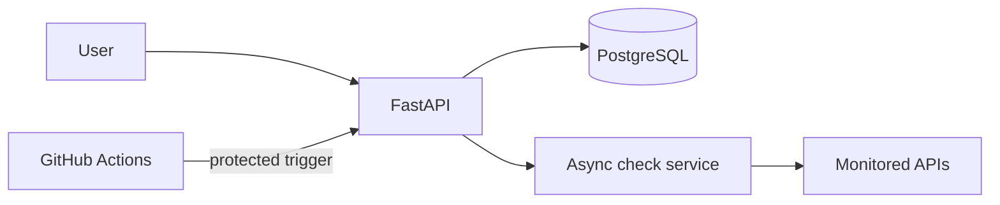

# Uptime Monitor

A portfolio project for monitoring API availability and response time.

## Planned stack

- Python 3.14 and FastAPI
- PostgreSQL
- Docker
- GitHub Actions

## Project status

Current milestone: FastAPI health endpoints, PostgreSQL models and migration, JWT signup/login, owner-scoped monitor management, and a bounded asynchronous check runner.

## Architecture

## API endpoints

- `POST /auth/register` — create an account
- `POST /auth/login` — receive a short-lived bearer token
- `GET /auth/me` — view the authenticated account
- `POST /monitors` — create a monitor (authentication required)
- `GET /monitors` — list your monitors (authentication required)
- `GET /monitors/{id}` — view a monitor (authentication required)
- `PATCH /monitors/{id}` — update a monitor (authentication required)
- `DELETE /monitors/{id}` — delete a monitor (authentication required)
- `GET /monitors/{id}/results` — view recent check history (authentication required)
- `POST /internal/run-due-checks` — run due checks (scheduler bearer token required)
- `GET /health` — API process health
- `GET /health/database` — PostgreSQL connectivity

## Free-tier deployment note

This is a portfolio demo. Free hosting may sleep when idle, and scheduled jobs may be delayed. It does not provide a production uptime guarantee.

## CI and deployment

GitHub Actions runs Ruff, the unit suite, and a Docker build on pushes and pull requests. A push to `main` runs the Alembic migration and triggers Render when deployment secrets are configured. A scheduled workflow requests due checks every five minutes; GitHub may delay scheduled runs.

Add these repository secrets to enable deployment and scheduled checks:

- `DATABASE_URL` — Neon PostgreSQL connection string used by the migration job.
- `RENDER_DEPLOY_HOOK` — Render deploy hook URL.
- `MONITOR_API_URL` — base URL of the deployed API, without a trailing slash.
- `SCHEDULER_TOKEN` — same token configured on the API service.

Configure `DATABASE_URL`, `JWT_SECRET`, and `SCHEDULER_TOKEN` in the Render service environment as well. Never commit `.env` or copy secret values into issues or logs.

## Local development

1. Copy `.env.example` to `.env` and set `DATABASE_URL` to your PostgreSQL connection string.
2. Install dependencies: `python -m pip install -r requirements.txt`.
3. Apply the database schema: `alembic upgrade head`.
4. Start the API: `python -m uvicorn app.main:app`.

The `.env` file contains secrets and must never be committed.
