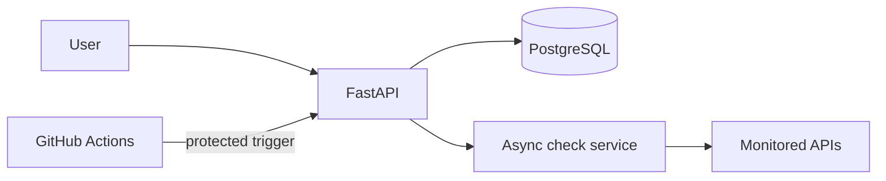

# Uptime Monitor

A portfolio project for monitoring API availability and response time.

## Planned stack

- Python 3.14 and FastAPI
- PostgreSQL
- Docker
- GitHub Actions

## Project status

This project is being built in phases. The first milestone is a small API that can create monitors and run bounded, asynchronous HTTP checks.

## Architecture

## Free-tier deployment note

This is a portfolio demo. Free hosting may sleep when idle, and scheduled jobs may be delayed. It does not provide a production uptime guarantee.
