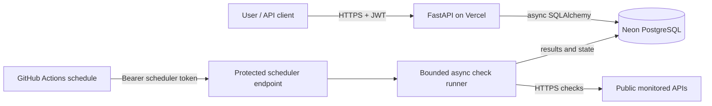
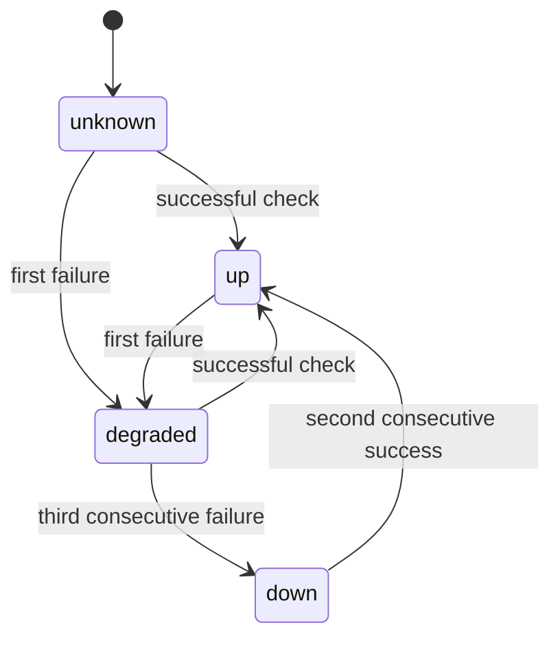

# Distributed Uptime & API Performance Monitor

A small, serverless uptime monitoring service built with FastAPI, PostgreSQL, and asynchronous HTTP checks. It lets users register, create monitors, and inspect recent availability and latency results.

## Live demo

- **Interactive API docs:** https://uptime-monitor-mauve.vercel.app/docs
- **API health:** https://uptime-monitor-mauve.vercel.app/health
- **Database health:** https://uptime-monitor-mauve.vercel.app/health/database

The demo uses free-tier services. The API or database may be cold after a period without traffic, and scheduled runs can be delayed. This project is a portfolio demo and does not provide a production uptime guarantee.

## Features

- JWT authentication with Argon2 password hashing.
- Owner-scoped monitor CRUD and paginated monitor listing.
- Asynchronous HTTP checks with bounded concurrency, request timeouts, one retry for transient network errors, and TLS/DNS/HTTP error classification.
- Public destination checks to reduce server-side request forgery (SSRF) risk.
- Optional Discord webhook notifications when a monitor becomes `down` or recovers to `up`.
- PostgreSQL check history with response code, latency, outcome, and error detail.
- Per-monitor summary metrics for a 1-hour to 30-day window, including sample-based success rate, average latency, and p95 latency.
- Failure dampening: a monitor becomes `down` after three consecutive failures and recovers after two consecutive successes.
- GitHub Actions schedules due checks every five minutes and runs linting, unit tests, and a Docker build.

## Architecture



Vercel deploys the FastAPI app from the GitHub repository. Neon stores accounts, monitors, and results. A scheduled GitHub Actions workflow calls the protected API endpoint; Vercel Hobby cron is not used because it only supports daily schedules.

## Check processing and state changes

The scheduler claims at most 100 due monitors per run. It uses a semaphore and HTTPX connection limits to run no more than 20 checks at once. Each target has a configured timeout. Transient network errors get one short retry; non-retryable outcomes are recorded without retrying. Results are persisted after the network calls complete.



Discord alerts are sent only for critical `down` and recovery transitions, not for the first degraded result. Delivery is best-effort: failures are logged without exposing the webhook token, but are not queued for a later retry.

## Data model and indexing

- `accounts`: unique email, password hash, role, and creation time.
- `monitors`: owner foreign key, target URL/method, interval, timeout, current state, counters, and next due time.
- `check_results`: append-only observations with latency, HTTP status, outcome, and timestamp.

Indexes support due-monitor selection, account monitor listing, and recent result history. Account deletion cascades to its monitors; monitor deletion cascades to its check results. Alembic owns schema changes.

The summary's uptime percentage is the percentage of successful checks in the selected window; it is sample-based, not time-weighted. Average and p95 latency use successful checks with recorded latency. The default window is 24 hours, and requests can select 1 to 720 hours.

## API overview

| Endpoint | Purpose |
|---|---|
| `POST /auth/register` | Create an account |
| `POST /auth/login` | Get a bearer access token |
| `GET /auth/me` | Get the authenticated account |
| `POST /monitors` | Create a monitor |
| `GET /monitors` | List owned monitors |
| `GET /monitors/{monitor_id}` | Get a monitor |
| `GET /monitors/{monitor_id}/results` | Get recent check history |
| `GET /monitors/{monitor_id}/summary?hours=24` | Get sample-based uptime and latency summary |
| `PATCH /monitors/{monitor_id}` | Update a monitor |
| `DELETE /monitors/{monitor_id}` | Delete a monitor |
| `POST /internal/run-due-checks` | Trigger due checks with the scheduler bearer token |
| `GET /health` | Check API process health |
| `GET /health/database` | Check PostgreSQL connectivity |

Interactive requests and schemas are available at `/docs`.

## Tech stack

- Python 3.14, FastAPI, Pydantic
- SQLAlchemy 2 async ORM, asyncpg, Alembic
- Neon PostgreSQL
- HTTPX for asynchronous outbound checks
- JWT and Argon2 password hashing
- Docker multi-stage build
- GitHub Actions for lint, tests, image build, and scheduled checks
- Vercel Hobby for the API deployment

## Run locally

Use Python 3.14 and a PostgreSQL database (Neon works for local development).

```powershell
py -3.14 -m venv .venv
.\.venv\Scripts\Activate.ps1
python -m pip install -r requirements-dev.txt
Copy-Item .env.example .env
```

Edit `.env` and set `DATABASE_URL`, `JWT_SECRET`, and `SCHEDULER_TOKEN`. Keep the file private and never commit it. Apply migrations and start the server:

```powershell
python -m alembic upgrade head
python -m uvicorn app.main:app
```

Open `http://127.0.0.1:8000/docs` for the interactive API. The scheduler endpoint needs the `SCHEDULER_TOKEN` as a bearer token.

## CI and deployment

- GitHub Actions runs Ruff, the unit tests, and a Docker image build for pushes and pull requests.
- Vercel's GitHub integration deploys commits from `main` to the production API.
- A scheduled GitHub Actions run calls `/internal/run-due-checks` every five minutes. GitHub may delay scheduled runs.

Configure these values as GitHub Actions repository secrets for scheduled checks:

- `MONITOR_API_URL`: production base URL without a trailing slash.
- `SCHEDULER_TOKEN`: the same secret configured in Vercel.

Configure these variables in Vercel for the Production environment:

- `DATABASE_URL`: Neon PostgreSQL connection string.
- `JWT_SECRET`: long, random signing secret.
- `SCHEDULER_TOKEN`: long, random scheduler secret.
- `ALERT_WEBHOOK_URL`: optional Discord webhook URL for down and recovery notifications. Store it as a Secret.

Keep credentials out of source control, screenshots, and issue comments. `.env` is ignored by Git.

## Architectural decisions

1. **PostgreSQL is the source of truth.** Monitor state and check history are persisted together so the API can serve current status and recent observations.
2. **The scheduler is stateless.** GitHub Actions invokes an authenticated API route; the database selects and locks due rows, allowing multiple invocations without requiring a continuously running worker.
3. **Concurrency is bounded.** Each run is limited to 100 monitors and 20 active checks to control memory, sockets, and database pressure on small free-tier services.
4. **Failure state is dampened.** Consecutive-failure and recovery thresholds avoid flipping state on a single transient error.
5. **The checker rejects private destinations.** URL checks and DNS resolution checks reduce SSRF risk when users submit targets.
6. **Free-tier hosting has limits.** Cold starts, best-effort schedule timing, and provider quotas are accepted trade-offs for a no-cost portfolio deployment.

## Current verification

The live demo has been exercised end-to-end: account authentication, monitor listing, scheduled checks, and check-history retrieval. The current example monitor has returned HTTP 200 responses and is in the `up` state.
