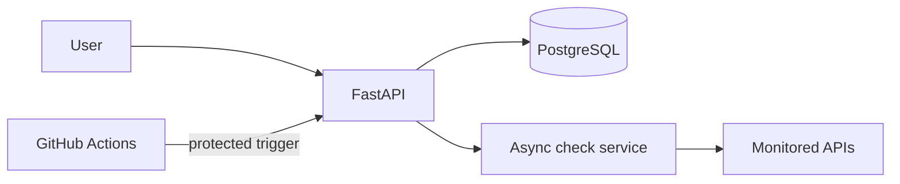

# Uptime Monitor

A portfolio project for monitoring API availability and response time.

## Planned stack

- Python 3.14 and FastAPI
- PostgreSQL
- Docker
- GitHub Actions

## Project status

Current milestone: FastAPI health endpoints, PostgreSQL models, and an Alembic migration for the initial schema. Monitor management and bounded asynchronous checks are planned next.

## Architecture

## Free-tier deployment note

This is a portfolio demo. Free hosting may sleep when idle, and scheduled jobs may be delayed. It does not provide a production uptime guarantee.

## Local development

1. Copy `.env.example` to `.env` and set `DATABASE_URL` to your PostgreSQL connection string.
2. Install dependencies: `python -m pip install -r requirements.txt`.
3. Apply the database schema: `alembic upgrade head`.
4. Start the API: `python -m uvicorn app.main:app`.

The `.env` file contains secrets and must never be committed.
